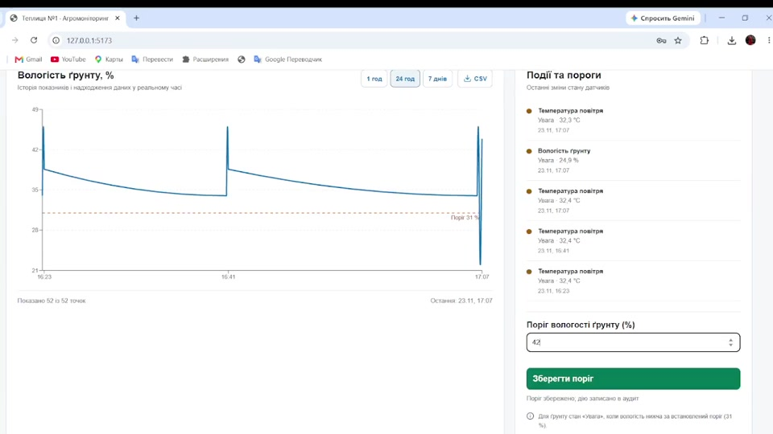

# Greenhouse API

Навчальна IoT-система агромоніторингу: вологість ґрунту, температура, вологість повітря, освітленість, історія та пороги поливу. Сервер приймає MQTT, зберігає SQLite й передає події через Socket.IO. Вебклієнт — React.



## Швидкий старт (Windows)

Передумови: Git, Docker Desktop (запущений), Node.js 22 або 24 і npm. Для нового локального навчального середовища:

```powershell
git clone https://github.com/eugeniuskorbilo/greenhouse-api.git
cd greenhouse-api
powershell -ExecutionPolicy Bypass -File scripts/start-demo.ps1
```

Сценарій створює `.env` із випадковим секретом, якщо його немає, запускає API та брокер, додає навчальних користувачів і демонстраційні дані, встановлює залежності React та відкриває сервер Vite (термінал має залишатися відкритим). Відкрийте <http://localhost:5173/>. API: <http://localhost:4000/api/v1/health>.

Локальні демо-облікові записи: `agro1` / `Agro#2026` та `viewer1` / `View#2026`. Це публічні тестові дані, не паролі для реального розгортання. Не відкривайте демо-середовище в публічну мережу.

## Конфігурація

| Змінна | Призначення | Значення для Compose |
| --- | --- | --- |
| `JWT_SECRET` | Ключ HS256 (не менше 32 символів) | Власний секрет |
| `PORT` | HTTP-порт | `4000` |
| `MQTT_URL` | Адреса брокера | `mqtt://mqtt:1883` |
| `DB_PATH` | Файл SQLite | `/app/data/telemetry.db` |
| `ACCESS_TTL` | Строк access JWT | `15m` |
| `REFRESH_TTL_DAYS` | Строк refresh-токена | `7` |

`.env` не комітиться. `.env.example` містить плейсхолдери. За ручного запуску скопіюйте приклад і замініть `JWT_SECRET`; подробиці — [розгортання](docs/OPERATIONS.md).

## Документація

- [Архітектура](docs/architecture/README.md)
- [OpenAPI](docs/openapi.yaml) та [MQTT / Socket.IO](docs/PROTOCOLS.md)
- [ADR](docs/adr/README.md)
- [Матриця трасованості](docs/TRACEABILITY.md)
- [Експлуатація](docs/OPERATIONS.md)
- [Пояснювальна записка](docs/report/report.docx)
- [Демонстрація](docs/DEMO.md)
- [Інвентаризація](docs/INVENTORY.md)
- [Історія змін](CHANGELOG.md)

## Перевірки

```powershell
npm ci
npm run lint
npm run test:coverage
node --test property.test.js
npx stryker run
```

Для Playwright: встановіть залежності у `client`, виконайте `npx playwright install chromium`, далі `npm run test:e2e`. Браузерні тести підміняють REST-відповіді.

## Межі реалізації

Flutter-клієнт продемонстровано у ПР5 до захищеного API; після ПР6 він потребує інтеграції JWT. Push, журнал фактичних поливів, керування обліковими записами через API та фізичне керування клапаном не є завершеними функціями поточного backend. Production Compose піднімає API та MQTT, а не вебклієнт.
