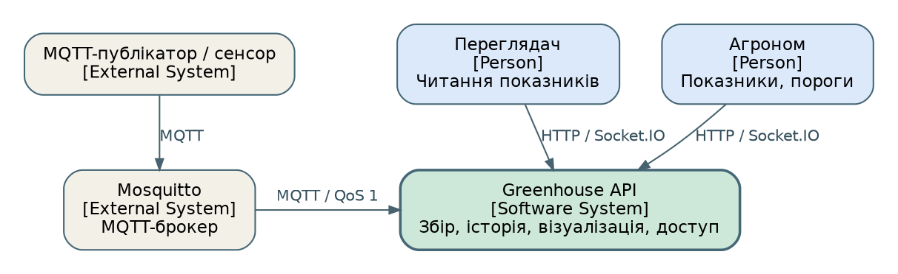
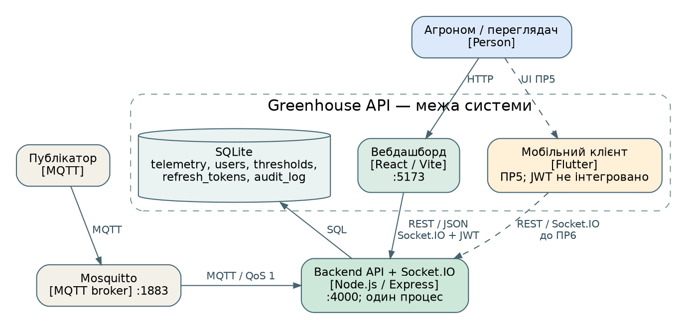

# Архітектура

Діаграми уточнено за фактичним кодом ПР8/С8 та описом ПР1. Socket.IO і Express — один процес, не окремі контейнери C4. Пунктир позначає попередню мобільну інтеграцію або неповний сценарій.

## C4-Context

Вихідники: [Mermaid](context.mmd), [Graphviz](context.dot).

## C4-Container

Вихідники: [Mermaid](container.mmd), [Graphviz](container.dot).

## Сценарії, потік і розгортання

- [Use-case](use-case.png) ([вихідник](use-case.dot))
- [Потік телеметрії](flow.png) ([вихідник](flow.dot))
- [Компоненти React](client.png) ([вихідник](client.dot))
- [Розгортання](deploy.png) ([вихідник](deploy.dot))

Для повторного експорту Graphviz: `dot -Tpng -Gdpi=150 docs/architecture/container.dot -o docs/architecture/container.png`. Mermaid-вихідники також можна відкрити в Mermaid Live Editor; експорт PNG у пакеті зроблено з DOT.
